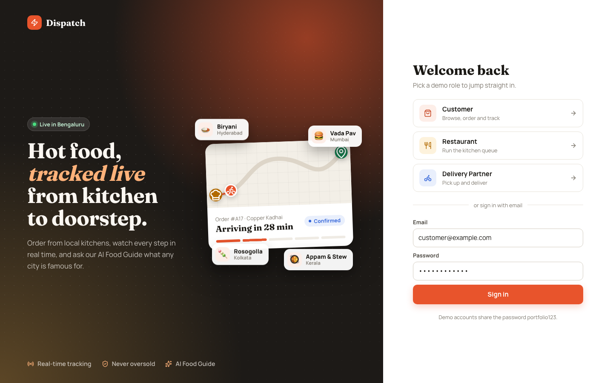
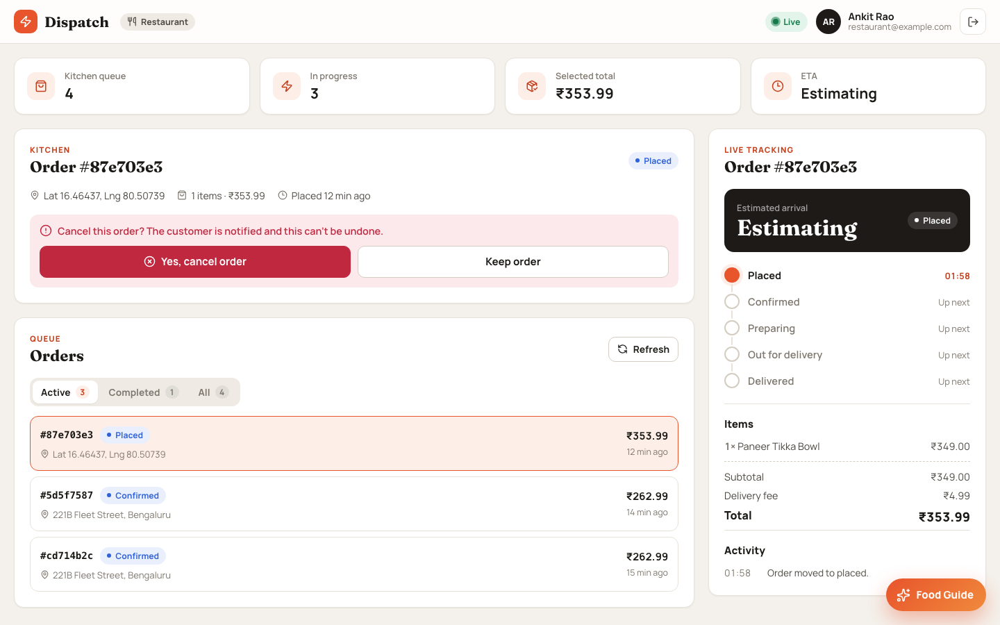
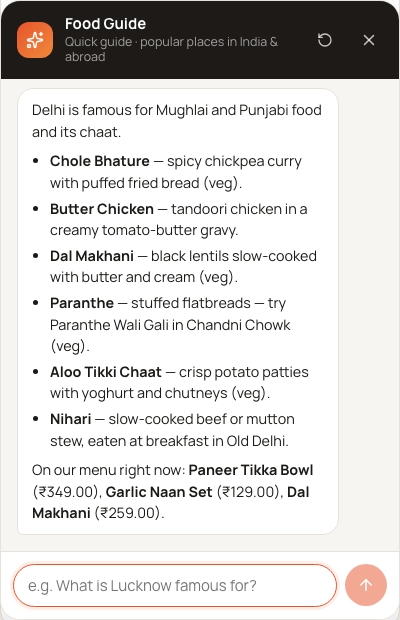
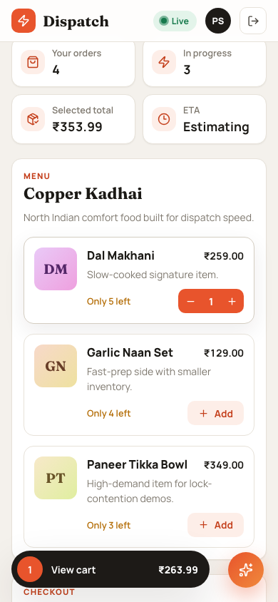
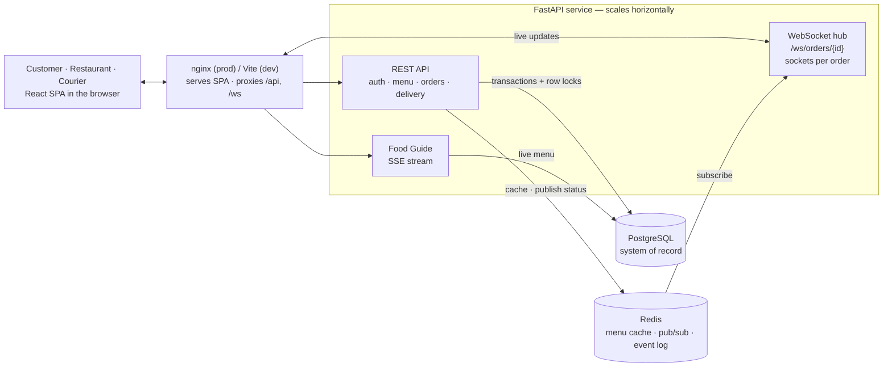
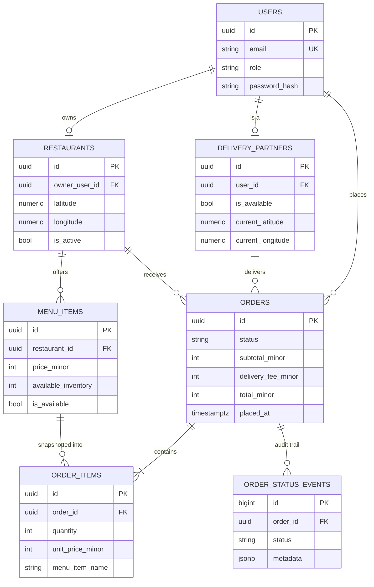
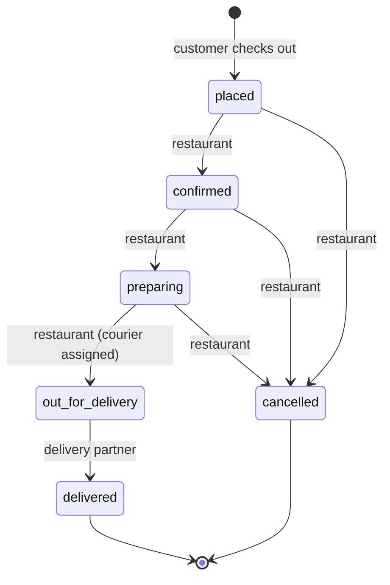
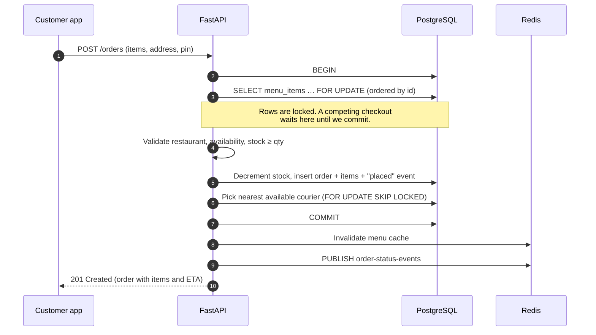
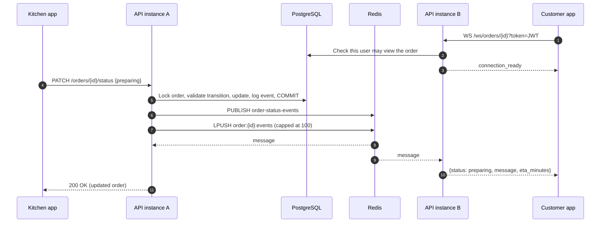
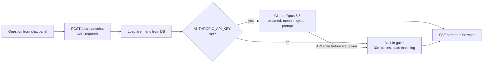

# Dispatch — Real-Time Food Ordering & Delivery Tracking

A full-stack food delivery platform where customers order, kitchens cook, and couriers deliver, with every status change pushed live to everyone watching the order. It's built around a few problems that real delivery platforms have: **never overselling the last item**, **keeping every screen in sync in real time**, and **assigning the nearest available courier** without two orders grabbing the same one.

**Stack:** FastAPI · PostgreSQL · Redis · WebSockets · React 18 + Vite · Leaflet · Docker · Claude API (optional)



| Kitchen dashboard | Food Guide chatbot | Mobile |
| --- | --- | --- |
|  |  |  |

## Features

- **Three roles, one app:** customers browse and order, restaurants run the kitchen queue, delivery partners share their location and complete deliveries.
- **Live tracking:** status changes reach every open screen over WebSockets in real time, with a timeline, ETA and activity log.
- **Oversell-proof checkout:** stock is decremented under row-level locks inside one transaction.
- **Nearest-courier dispatch:** haversine distance plus an ETA estimate, with lock-skipping so concurrent dispatches never pick the same courier.
- **Map-based addresses:** pick a delivery pin on a Leaflet map or use browser GPS.
- **Food Guide chatbot:** ask what any place is famous for; it also points to matching dishes on the live menu. It uses Claude when an API key is set and a built-in guide otherwise.
- **One-command startup:** Docker Compose runs migrations and seeds demo data automatically.

---

## System design

### High-level architecture



| Component | Responsibility |
| --- | --- |
| **PostgreSQL** | Source of truth: users, restaurants, menus and inventory, orders, order items, courier state, and an append-only status audit log. |
| **Redis** | Menu read cache (120 s TTL, invalidated on checkout), pub/sub channel `order-status-events` for real-time fan-out, and a capped per-order event list (`order:{id}:events`, last 100). |
| **FastAPI** | Async REST API for transactional operations; WebSocket endpoint for live tracking; SSE endpoint for the chatbot. All business rules (state machine, permissions, locking) live in the service layer. |
| **React + Vite** | Single-page app with role-specific workspaces. Talks to the API via a same-origin proxy, so no CORS setup is needed in production. |
| **nginx** (prod) | Serves the built SPA and reverse-proxies `/api` and `/ws`; response buffering is off so streamed chat replies arrive token by token. |

### Data model



Design choices:

- **Money in minor units** (`price_minor` in paise) to avoid floating-point rounding.
- **Order items snapshot name and price** at checkout, so later menu edits never rewrite order history.
- **Per-status timestamps** on `orders` (`confirmed_at`, `delivered_at`, …) for fast reporting, plus a full `order_status_events` log for auditing who changed what.

The full column-level schema is in [`docs/schema.md`](docs/schema.md) and [`backend/schema.sql`](backend/schema.sql).

### Order lifecycle (state machine)



Every transition is checked twice in [`order_state.py`](backend/app/services/order_state.py):

1. **Is the move legal?** (e.g. `delivered → preparing` → `409 Conflict`)
2. **Is this role allowed to make it?** (e.g. a customer confirming an order → `403 Forbidden`)

The order row is locked (`SELECT … FOR UPDATE`) while it transitions, so two people clicking at once can't both apply a change. Delivering or cancelling an order frees its courier.

### Placing an order: preventing overselling

The classic race: two customers both see "1 left" and both check out. The checkout path in [`orders.py`](backend/app/services/orders.py) runs as one transaction:



**Why pessimistic locking?** Checkout is correctness-critical and the conflicts we care about ("last plate of biryani") are exactly the high-contention case. There, optimistic locking turns into retry storms, while row locks give a simple, strong guarantee. Locks are taken **in a consistent order (by id)** so two multi-item orders can't deadlock each other.

**Trade-off:** checkouts for the *same* item queue up behind each other, so per-item throughput is bounded by transaction time. That's acceptable for a restaurant menu. Optimistic locking would win if conflicts were rare.

### Real-time updates: fan-out over Redis pub/sub



- Each API instance keeps an in-memory map of `order_id → open sockets` and subscribes to one Redis channel. Publishing once reaches **every instance**, so customers, kitchens and couriers stay in sync even when they're connected to different servers. This is what makes horizontal scaling possible.
- Sockets authenticate with the same JWT as the REST API and are checked for access to that specific order. Unauthorised or unknown orders are closed with codes `4403` / `4404`.
- Events are published **after** the database commit, so clients never see a status that could still roll back.
- **Why WebSockets instead of polling?** Updates arrive with low latency and no wasted requests while an order is being watched. The cost is connection management, which the connection manager handles: it prunes dead sockets on send.

### Courier assignment

[`delivery.py`](backend/app/services/delivery.py) picks the **nearest available courier** to the restaurant by great-circle (haversine) distance and estimates:

```
eta_minutes = ceil(distance_km / 20 km/h × 60) + 12 min prep buffer
```

Candidates are read with `FOR UPDATE SKIP LOCKED`. If two orders dispatch at the same moment, each skips couriers the other is already considering instead of waiting or double-booking. Assignment happens at checkout, with a retry when the kitchen hands the order over if no courier was free earlier. Speed and prep buffer are configurable.

*Deliberately simple:* this ignores live traffic, batching and courier heading; production dispatch would add zones and route optimisation.

### Food Guide chatbot



- Answers stream to the browser as Server-Sent Events, so text appears as it's generated.
- The live menu (names, prices, stock) goes into the prompt, so the assistant can recommend dishes you can actually order. It's instructed never to invent items or prices.
- The **built-in guide** ([`food_knowledge.py`](backend/app/services/food_knowledge.py)) covers 32 Indian cities/states and countries, understands old names (Bombay, Calcutta, Madras) and follow-up questions. It keeps the feature working with no API key and takes over if the AI service is unreachable.
- The API key stays on the server and the endpoint requires sign-in.

### Resilience

| If this is down… | …the system |
| --- | --- |
| Redis | Serves menus straight from PostgreSQL and broadcasts status changes in-process (single-instance mode). |
| PostgreSQL (local dev) | Falls back to a seeded SQLite database so the demo still runs. |
| Claude API / no key | Food Guide answers from its built-in guide. |

### Scaling notes

- **API tier** is stateless apart from open sockets; add instances behind a load balancer (with sticky sessions or a WebSocket-aware balancer) and Redis pub/sub keeps them in sync.
- **Read load** (menus) is absorbed by the Redis cache; checkout invalidates it so stock counts stay accurate.
- **Write contention** is per menu item, not global, because locks are row-level.
- **Next steps** for production scale: WebSocket heartbeats and client auto-reconnect with replay from `order:{id}:events`, an outbox table so publishing can't be lost between commit and publish, and read replicas for order history.

---

## API

All endpoints are under `/api/v1` and use `Authorization: Bearer <JWT>` unless noted.

| Method | Path | Who | Purpose |
| --- | --- | --- | --- |
| `POST` | `/auth/login` | public | Exchange email + password for a JWT (8 h) |
| `GET` | `/auth/me` | any | Current user profile |
| `GET` | `/restaurants` | public | Active restaurants |
| `GET` | `/restaurants/{id}/menu` | public | Menu with live stock (Redis-cached) |
| `POST` | `/orders` | customer | Place an order (locks stock, assigns courier) |
| `GET` | `/orders` | any | Orders visible to the caller's role |
| `GET` | `/orders/{id}` | involved parties | Order detail with items and totals |
| `GET` | `/orders/{id}/events` | involved parties | Status audit trail |
| `PATCH` | `/orders/{id}/status` | restaurant, courier | Move the order through the state machine |
| `PATCH` | `/delivery/me/location` | courier | Update location and availability |
| `POST` | `/assistant/chat` | any | Food Guide chat (SSE stream) |
| `WS` | `/ws/orders/{id}?token=…` | involved parties | Live status updates |

Interactive docs: http://localhost:8000/docs

---

## Getting started

**Requirements:** Docker Desktop.

```bash
git clone https://github.com/aashutosh-k-das/Real-time-food-ordering-system.git
cd Real-time-food-ordering-system
docker compose up --build
```

This starts PostgreSQL, Redis, the API (running migrations and seeding demo data) and the frontend.

- App: http://localhost:5173
- API docs: http://localhost:8000/docs

**Demo accounts** (password `portfolio123`), or use the one-click role buttons on the login page:

| Role | Email |
| --- | --- |
| Customer | `customer@example.com` |
| Restaurant | `restaurant@example.com` |
| Delivery partner | `delivery@example.com` |

**Try the full flow:** sign in as the customer and place an order. In another browser window, sign in as the restaurant and move it through *Accept → Start preparing → Hand to courier*. The customer's tracking panel updates live. Finish as the delivery partner with *Mark delivered*.

**Optional — AI answers in the Food Guide:**

```bash
export ANTHROPIC_API_KEY=sk-ant-...
docker compose up -d backend
```

**Production-style stack** (nginx-served build on port 80):

```bash
docker compose -f docker-compose.prod.yml up --build
```

Manual (non-Docker) setup is in [`docs/runbook.md`](docs/runbook.md).

## Tests

```bash
docker compose exec backend pytest
```

Covers the state machine and role rules, courier distance/ETA maths, and password hashing / JWT handling.

## Project structure

```
backend/
  app/
    api/            # FastAPI routers: auth, restaurants, orders, delivery, assistant
    services/       # Business logic: checkout + locking, state machine, dispatch,
                    #   menu cache, event fan-out, Food Guide
    websocket/      # Connection manager and broadcaster
    models.py       # SQLAlchemy models
    schemas/        # Pydantic request/response models
  migrations/       # Alembic migrations
  scripts/          # DB bootstrap and seed
  tests/
frontend/
  src/
    App.jsx         # Role workspaces: login, menu/checkout, kitchen/courier, tracking
    components/     # Map, status timeline/badges, Food Guide chat
    hooks/          # useOrderSocket (live updates)
    api/            # REST + SSE client
docs/               # Schema notes, runbook, screenshots
```

## Security notes

- Passwords hashed with PBKDF2-SHA256 and a per-user salt; JWTs signed with HS256 and expire after 8 hours.
- Role checks are enforced server-side on every transition, not just hidden in the UI.
- WebSocket subscriptions are authorised per order.
- The demo `JWT_SECRET` in the compose files is for local use only; set your own for any real deployment.
